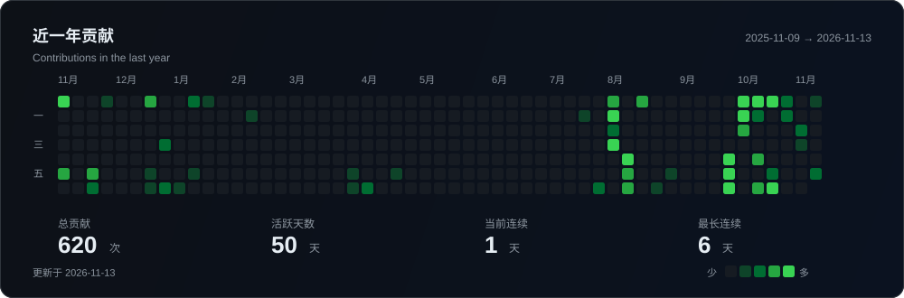

# 橘络peroe

**GitHub · 自建服务 · Cloudflare**

## 关于我

- 喜欢折腾 GitHub、Cloudflare 和自建服务
- 平时写一点前端、脚本和小工具
- 主要在这里记录项目、实验和折腾过程

## 贡献

## 技术栈

## 找到我

- GitHub：[@JuLuogo](https://github.com/juluogo)
- QQ：1576586736
- 邮箱：<juluogogo@163.com>
